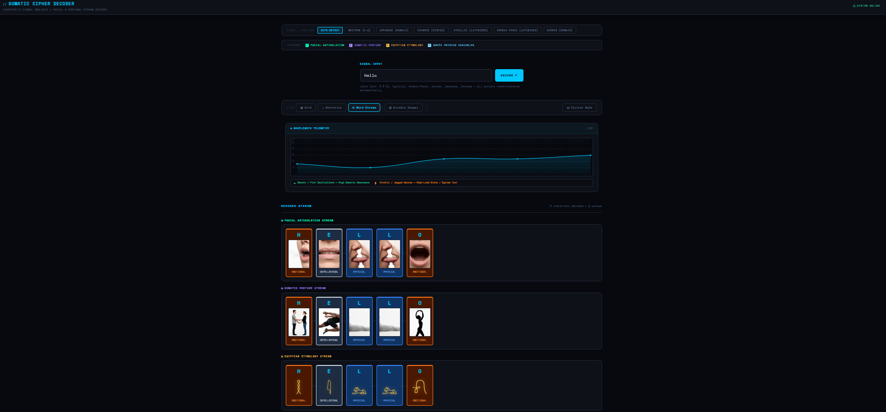
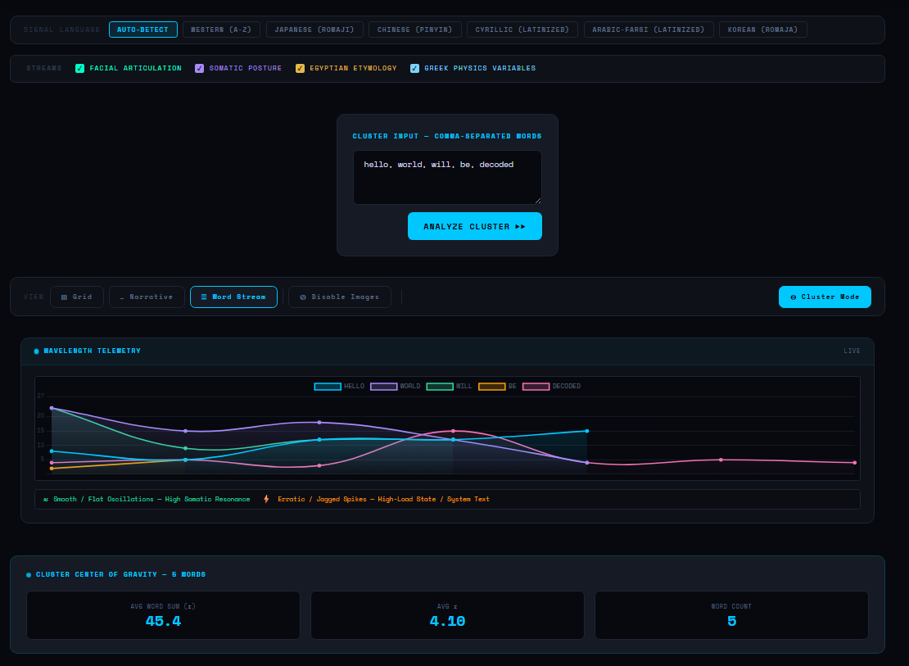
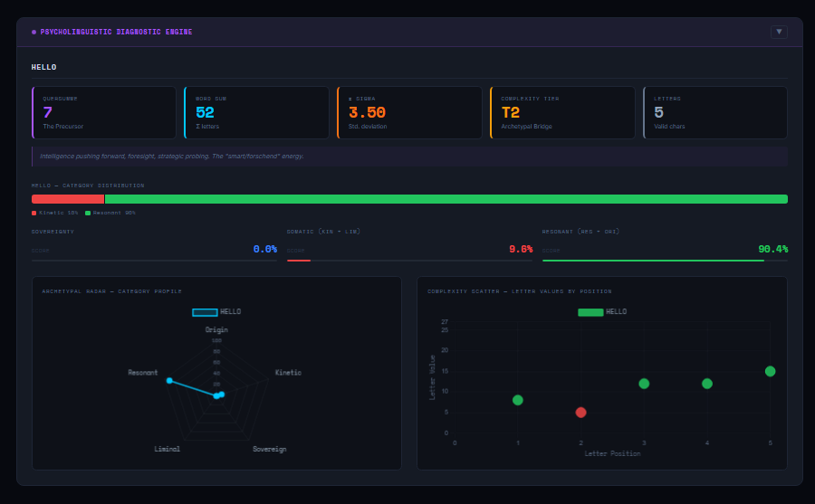
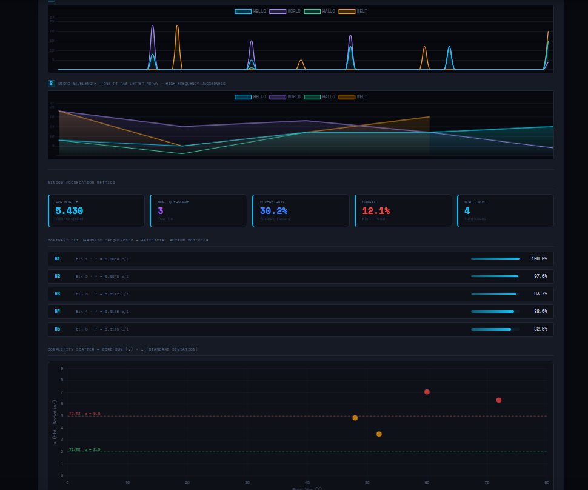

# Somatic Cipher Decoder — v7.0

A pure client-side research tool that treats language as a **physical frequency signal**. It decodes alphanumeric text into visual dashboards of facial articulation, somatic posture, Egyptian hieroglyphic etymology, and Greek physics variables — then runs real-time oscilloscope waveforms, performs full spectral analysis (FFT), clusters semantic word groups into geometric scatter fields, maps words through the NRC VAD ousiometric transformation, runs multilingual 8-dimensional NRC emotion intensity analysis, and cross-compares psycholinguistic profiles across up to 6 languages simultaneously — all with zero backend dependencies.

---

## Screenshots

### Single Word Decoder — Overview


### Cluster Mode — Overview


### Psycholinguistic Diagnostic Engine


### Spectral Analysis Engine


---

## Features

### Decoder Streams

Each decoded character is rendered across **four parallel visual streams**. Streams can be toggled on/off individually via the **STREAMS** selector bar — visibility changes are instant (CSS body-class technique, no re-render).

| Stream | Accent | Description |
|---|---|---|
| **Facial Articulation** | Teal | Photographic image of the facial gesture for each character |
| **Somatic Posture** | Violet | Photographic image of the body/postural expression |
| **Egyptian Etymology** | Amber `#e8b84b` | Unicode hieroglyph + description of the character's ancient Egyptian root |
| **Greek Physics Variables** | Sky blue `#7dd3fc` | Greek letter (e.g. α, β, Δ) with its classical physics interpretation |

---

### View Modes

| View | Description |
|---|---|
| **Grid** | Each decoded character renders as a card with all four streams |
| **Narrative** | Horizontal scrollable timeline — each character is a node containing all four stream glyphs |
| **Word Stream** | Four parallel strips — one per stream — all characters in sequence |
| **Cluster Mode** | Comma-separated word list; outputs Center of Gravity metrics, a word table, a Cluster Scatter, and per-word character streams |
| **Disable Images** | Toggle in the controls bar that instantly hides all character image cards in single and cluster mode |

---

### Global Localization Bridge

Transliterates non-Latin scripts into the Latin alphabet before passing input through the physics engine. Accessible via the **SIGNAL LANGUAGE** bar above the input. Supports **eight modes**.

| Mode | Engine | How it works |
|---|---|---|
| **AUTO-DETECT** | — | Unicode heuristic: Hiragana/Katakana → Japanese; CJK Ideographs → Chinese; Cyrillic → Cyrillic; Arabic block → Arabic; Hangul → Korean; otherwise Western |
| **WESTERN (A–Z)** | — | Pass-through; no transliteration |
| **FRENCH (FR)** | — | Pass-through Latin; pins VAD lexicon to French (`vad-fr.json`) — overrides auto-detect for French text that lacks accented characters |
| **JAPANESE (ROMAJI)** | [Kuroshiro](https://github.com/hexenq/kuroshiro) + [Kuromoji](https://github.com/takuyaa/kuromoji) | Converts mixed Kanji/Kana to Romaji; also routes VAD lookup to `vad-ja.json` |
| **CHINESE (PINYIN)** | [pinyin-pro](https://github.com/zh-lx/pinyin-pro) | Converts Hanzi to tone-stripped Pinyin (ā → a); routes VAD to `vad-zh.json` |
| **CYRILLIC (LATINIZED)** | Built-in map | 66-entry map covering lowercase, uppercase, and Ukrainian/Bulgarian variants (щ→shch, ш→sh, ж→zh, я→ya, etc.) |
| **ARABIC-FARSI (LATINIZED)** | Built-in map | `NFKC` normalization collapses FB50–FEFF presentation forms to canonical 0600–06FF block first; then consonant + diacritic strip map; Farsi extras (پ→p, چ→ch, ژ→zh, گ→g); Arabic-Indic digits (٠–٩ → 0–9) |
| **KOREAN (ROMAJA)** | Built-in decomposer | Zero-dependency Unicode decomposition: `idx = cp − 0xAC00`; choseong / jungseong / jongseong extracted by formula; mapped to 19 initials, 21 vowels, 28 finals; routes VAD to `vad-ko.json` |

**Intercepted Base Signal box** — visible after a Japanese, Chinese, Cyrillic, Arabic/Farsi, or Korean decode. Shows the exact Latinized string fed to the engine.

---

### Ousiometric PDS Engine

A full psycholinguistic vector analysis panel on the main dashboard, driven by the NRC VAD (Valence–Arousal–Dominance) Lexicon. Fires automatically after every decode.

#### Language support

Eight languages share the same detection pipeline as the Signal Language bar. Auto-detect uses Unicode script ranges (Arabic, CJK, Hiragana/Katakana, Hangul) and character/word-level heuristics (German umlauts, Spanish ñ, French ç/œ). Explicit language buttons always take priority.

| Language | VAD file | Auto-detect signal |
|---|---|---|
| English | `data/vad-en.json` | Default fallback |
| French | `data/vad-fr.json` | ç, œ, or French function words |
| German | `data/vad-de.json` | ä, ö, ü, ß, or German function words |
| Spanish | `data/vad-es.json` | ñ, ¡, ¿, or Spanish function words |
| Arabic | `data/vad-ar.json` | Arabic Unicode block U+0600–U+06FF |
| Chinese | `data/vad-zh.json` | CJK Unified Ideographs U+4E00–U+9FFF |
| Japanese | `data/vad-ja.json` | Hiragana U+3040–U+309F or Katakana U+30A0–U+30FF |
| Korean | `data/vad-ko.json` | Hangul U+AC00–U+D7AF |

Each lexicon is lazy-loaded on first use with in-flight promise deduplication — subsequent analyses for the same language resolve from memory with no network request.

#### Ousiometric transformation

Words are mapped from VAD space to Power–Danger–Structure (PDS) space using the transformation from Dodds et al. (arXiv:2110.06847):

```
Power     = clamp((D × 0.65) + (V × 0.35), 0, 1)
Danger    = clamp(((1−V) × 0.60) + (A × 0.40), 0, 1)
Structure = clamp((V × 0.55) + ((1−A) × 0.45), 0, 1)
```

#### [ OUSIOMETRIC THREAT MATRIX ]

Chart.js scatter plot — X = Power Index, Y = Danger Index.

| Element | Description |
|---|---|
| **Cyan dots** | Individual lexical units (matched VAD words) |
| **Red dots** | Apex threats — words where both Power ≥ 0.65 and Danger ≥ 0.65 |
| **Red dashed threshold lines** | Vertical at x=0.65, horizontal at y=0.65 |
| **Red shaded quadrant** | Top-right apex zone (High Power + High Danger) |
| **APEX ZONE label** | Annotated directly on the chart via a custom `afterDraw` plugin |
| **APEX THREAT alert banner** | Flashing red alert injected above the panel when any apex word is detected |

#### [ BASE P.D.S. TELEMETRY ]

Three animated horizontal progress bars showing the aggregate PDS signature across all matched tokens.

| Bar | Colour | Flash behaviour |
|---|---|---|
| **POWER** | Neon green gradient | — |
| **DANGER** | Red gradient | Flashes when aggregate Danger ≥ 0.65 |
| **STRUCTURE** | White gradient | Flickers when aggregate Structure < 0.25 |

---

### Multilingual Comparison Mode

A standalone analysis page (`comparison.html`) that takes any word or sentence, auto-detects the input language, translates it into up to 6 languages, and renders the full psycholinguistic analysis side-by-side in a comparison grid.

#### Translation engine

Offline in-browser translation powered by [Transformers.js (Xenova)](https://github.com/xenova/transformers.js) using quantized Hugging Face models — downloaded once and cached permanently by the browser. No API key, no server, no internet connection after the first model download.

| Language pair | Model | Size |
|---|---|---|
| English → German | `Xenova/opus-mt-en-de` | ~90 MB |
| English → French | `Xenova/opus-mt-en-fr` | ~90 MB |
| English → Spanish | `Xenova/opus-mt-en-es` | ~90 MB |
| English → Italian | `Xenova/opus-mt-en-it` | ~90 MB |
| Any ↔ Japanese | `Xenova/m2m100_418M` (Meta M2M-100) | ~420 MB |
| Non-English → English | Reverse opus-mt model per language | ~90 MB each |

Non-English inputs pivot through English first (source → EN via opus-mt, then EN → target). Japanese is handled end-to-end by M2M-100, which produces significantly better general-purpose translations than the OPUS-corpus opus-mt models.

#### Language detection

Automatic input language detection with a manual override dropdown:

| Signal | Languages |
|---|---|
| Japanese Unicode ranges (Hiragana/Katakana/CJK) | Japanese |
| German umlauts / ß | German |
| Spanish ñ / ¡ / ¿ | Spanish |
| French ç / œ | French |
| Italian àèìòù (without French chars) | Italian |
| Romanized Japanese dictionary (`sayonara`, `konnichiwa`, …) | Japanese |
| Known-word dictionary (`durst`, `bella`, `ciao`, `bonjour`, …) | German / Italian / French / Spanish |
| Trigram scoring (multi-word inputs) | All |
| Default fallback | English |

A **SOURCE** dropdown next to the detected label lets users override the auto-detected language when detection is wrong.

#### Comparison grid

Each language column displays:

| Section | Content |
|---|---|
| **Header** | Language flag, name, original or translated text, romanization (Japanese), speak button |
| **VAD bars** | Valence / Arousal / Dominance from NRC lexicon |
| **PDS bars** | Power / Danger / Structure (Ousiometric transform) |
| **Threat Matrix** | Chart.js scatter — Power × Danger with apex zone |
| **Emotion Radar** | 8-axis NRC emotion intensity radar |
| **Oscilloscope** | Micro-wave character-level waveform |
| **FFT Spectrum** | Power spectrum bins 1–32 (DC skipped), normalized |

#### Text-to-Speech

Each column header has a speak button (▶ / ■ toggle) that reads the translated text using the browser's Web Speech API. Voice selection prioritises Neural TTS voices (Windows 11 quality). A **speed toggle** (0.7× / 1× / 2×) applies globally across all columns — slow mode is useful for language learning.

---

### Psycholinguistic Cluster Analyzer

A standalone analysis page (`cluster-analyzer.html`) accessible via the **CLUSTER ANALYZER** button in the main dashboard header. Analyses word clusters against the NRC 8-Dimensional Emotion Intensity Lexicon.

#### Language support

Eight languages selectable from a dropdown in the input panel. Lexicons are lazy-loaded with in-flight deduplication — cached after first fetch.

| Option | Lexicon file |
|---|---|
| ENGLISH | `lexicons/nrc_8d_en.json` |
| ARABIC | `lexicons/nrc_8d_ar.json` |
| FARSI | `lexicons/nrc_8d_fa.json` |
| FRENCH | `lexicons/nrc_8d_fr.json` |
| JAPANESE | `lexicons/nrc_8d_ja.json` |
| KOREAN | `lexicons/nrc_8d_ko.json` |
| RUSSIAN | `lexicons/nrc_8d_ru.json` |
| CHINESE | `lexicons/nrc_8d_zh.json` |

All 8 emotion dimensions (`anger`, `fear`, `anticipation`, `disgust`, `surprise`, `trust`, `joy`, `sadness`) are always present for every word — missing scores default to `0.0`.

#### DOMINANT EMOTION SCATTER — σ × Σ Matrix

Chart.js scatter plot — X = Word Sum (Σ), Y = sigma (σ). Each dot is coloured by the word's dominant NRC emotion.

| Emotion | Abbreviation | Colour |
|---|---|---|
| Anger | ANG | `#FF3333` |
| Fear | FEA | `#9933FF` |
| Anticipation | ANT | `#FF8800` |
| Disgust | DIS | `#88FF00` |
| Surprise | SUR | `#FF00FF` |
| Trust | TRU | `#00FFFF` |
| Joy | JOY | `#FFD700` |
| Sadness | SAD | `#3366FF` |

Dots below the 0.5 dominant-emotion threshold render in the neutral accent colour (`#00c8ff`). Threshold lines at σ=2.0 (green, T1 boundary) and σ=5.0 (orange, T3 boundary) are drawn via a custom Chart.js plugin.

#### HIGH-DENSITY TELEMETRY HEATMAP — 8-D NRC Affect

A table with one row per word. Columns: `WORD`, `σ`, `Σ`, then one column per emotion. Each emotion cell background is computed as `rgba(R, G, B, intensity × 0.85 + 0.05)` — fully transparent at 0.0, fully saturated at 1.0.

#### HUD Compound Trigger Alerts

Two heuristic rules evaluated against the aggregate emotion profile of the entire word cluster. When triggered, a flashing critical banner appears at the top of the output area.

| Trigger | Rule | Interpretation |
|---|---|---|
| **Systemic Coercion** | avg σ > 4.0 AND avg Fear > 0.5 AND avg Trust > 0.5 | High structural complexity paired with simultaneous fear and trust — language engineered to demand compliance through intimidation and authority |
| **Volatile Populism** | avg σ < 2.5 AND avg Anger > 0.6 AND avg Disgust > 0.5 | Simple, blunt vocabulary maximising anger and disgust — language optimised for outrage and tribal polarisation |

The status bar and header badge both update with the active language code after each analysis (e.g. `ANALYSIS COMPLETE [RU] — 6 / 6 tokens matched`).

---

### Intercepted Wave Equation

Appears beneath the output section after every decode. Expresses each decoded word as a Greek physics equation:

```
WAVE_FUNC(WORD) = β + α + Δ + ...
```

Each term is the Greek physics variable assigned to the corresponding letter. Ionian numerals are used for numeric characters (e.g. `MI6` → `WAVE_FUNC(MI6) = μ + ι + ϛ'`).

---

### SIGINT Dossier Export

An **EXPORT SIGINT DOSSIER** button appears beneath the diagnostic panel after each decode. Clicking it calls `window.print()` with a purpose-built `@media print` stylesheet that:

- Applies a classification banner: `TOP SECRET // SIGINT // SOMATIC CIPHER ANALYSIS`
- Stamps a unique document ID (`SCD-` + base-36 timestamp) and ISO timestamp
- Lays cards in a 3-column B&W grid
- Converts stream images to greyscale
- Renders the wave equation in bold monospaced type
- Hides all UI chrome (header, controls, legend, guide, tooltips)

---

### Wavelength Telemetry

A real-time oscilloscope that fires on every keystroke. No button press required.

| Signal shape | Interpretation |
|---|---|
| Smooth / flat oscillations | High Somatic Resonance — letters with similar values |
| Erratic / jagged spikes | High-Load State / System Text — large value jumps |

- **X-axis** — letter position in the input sequence
- **Y-axis** — canonical letter value (A=1 … Z=26, Ä=1.5, Ö=15.5, Ü=21.5), range 0–27
- One waveform in single mode; one coloured line per word in Cluster Mode (14-colour shared palette)

---

### Psycholinguistic Diagnostic Engine

Triggered on every decode. Collapsible panel beneath the output.

#### Single-Word Mode

| Metric | Description |
|---|---|
| **Letters** | Count of valid (mapped) characters |
| **Quersumme** | Digital root (1–9) of the word sum, mapped to one of nine Archetypes |
| **Word Sum (Σ)** | Sum of all letter values |
| **σ (Sigma)** | Population standard deviation of the letter values |
| **Complexity Tier** | T1 σ<2.0 · T2 2.0≤σ<5.0 · T3 σ≥5.0 |
| **Category Distribution** | Segmented bar: % of total letter value per archetypal category |
| **Sovereignty / Somatic / Resonant scores** | Proportion of letter values from Sovereign · (Kinetic+Liminal) · (Resonant+Origin) |
| **Archetypal Radar** | 5-axis radar — Origin, Kinetic, Sovereign, Liminal, Resonant |
| **Complexity Scatter** | Letter value by position, coloured by category |

#### Cluster Mode (N words)

| Section | Description |
|---|---|
| **Per-word metric rows** | One row per word — Letters, Σ, σ, Tier badge, Quersumme + Archetype name |
| **Category distribution bars** | One segmented bar per word |
| **Scores table** | Sovereignty %, Somatic %, Resonant % for every word |
| **Archetypal Radar** | Multi-dataset radar — one polygon per word |
| **Cluster Balkendiagramm** | Horizontal bar chart — Word Sum per word; bar height adapts to word count (38 px/word) |

#### Cluster Scatter (in output section)

| Element | Description |
|---|---|
| **Center of Gravity** | Average Σ and average σ across all valid cluster words |
| **Word metrics table** | Per-word Σ, σ, Tier, Quersumme + Archetype |
| **Cluster Scatter** | X = Σ, Y = σ; dashed threshold lines at σ=2.0 and σ=5.0 |

---

### Spectral Analysis Engine

Always-visible section at the bottom. Driven entirely by the signal input.

**Live oscilloscopes (every keystroke)**

| Chart | Description |
|---|---|
| **A — Global Envelope** | 100-bucket mean value per bucket, smooth bezier — macro rhythmic structure |
| **B — Micro Wavelength** | First 256 raw letter values, zero tension — high-frequency character-level jaggedness |

**On DECODE (deep analysis)**

| Output | Description |
|---|---|
| **Window Aggregation Metrics** | Avg word σ, dominant Quersumme + Archetype, Sovereignty %, Somatic %, word count |
| **Dominant FFT Harmonics** | Radix-2 Cooley-Tukey FFT on 256-sample Hann-windowed signal; top 5 non-DC power bins — detects artificial rhythmic patterns |
| **Complexity Scatter (Word Sum × σ)** | One point per word; T1=green, T2=orange, T3=red |

---

### Contextual Tooltips

Small `[?]` badge buttons appear next to the labels of all key metrics and charts. Hovering reveals a single-floating dark popup (`position: fixed`, edge-clamped) with a 1–2 sentence plain-language explanation.

---

### Analyst Guide (Slide-Out Drawer)

An **ANALYST GUIDE** button in the top-right header opens a full-width slide-in panel. The drawer contains five sections: Core Metrics, Archetypal Radar, Complexity Scatter Plot, Oscilloscope, and Spectral Analysis / FFT.

---

### Linguistic Architecture Legend

A persistent floating overlay (bottom-right, `position: fixed`) styled with a sandy papyrus theme. Three tabs: **Geometrical Shape**, **Count of Lines**, **Proportion & Space**.

---

## Data Pipeline — NRC Lexicon Converter

`convert_nrc.py` — a command-line Python 3 script that converts raw NRC TSV data dumps into the compact JSON format consumed by both the PDS Engine and the Cluster Analyzer.

### Input formats

**NRC-EIL (8-D Emotion Intensity)** — one row per word-emotion pair:
```
English_Word    Emotion    Score    Translated_Word
outraged        anger      0.964    empört
```

**NRC-VAD** — one row per word, three scores:
```
English_Word    Valence    Arousal    Dominance    Translated_Word
abandon         0.052      0.519      0.245        aufgeben
```

The English-only root files have one fewer column and no header row; the `--word-col` and `--no-header` flags handle this automatically.

### Usage

```bash
# 8-D Emotion Intensity — translated file (header present, translated word in col 3)
python3 convert_nrc.py 8d raw/NRC-EIL\ \(8-D\ Emotions\)/NRC-AffectIntensity-Lexicon-de.txt \
    --out lexicons/nrc_8d_de.json

# 8-D Emotion Intensity — English root file (no header, word in col 0)
python3 convert_nrc.py 8d raw/NRC-EIL\ \(8-D\ Emotions\)/NRC-AffectIntensity-Lexicon-en.txt \
    --word-col 0 --no-header --out lexicons/nrc_8d_en.json

# VAD — translated file (header present, translated word in col 4)
python3 convert_nrc.py vad raw/NRC-VAD/NRC-VAD-Lexicon-de.txt \
    --out data/vad-de.json

# VAD — English root file (no header, word in col 0)
python3 convert_nrc.py vad raw/NRC-VAD/NRC-VAD-Lexicon-en.txt \
    --word-col 0 --no-header --out data/vad-en.json

# Batch-convert every .txt file in a directory
python3 convert_nrc.py batch --raw-dir raw --out-dir lexicons
```

### Output guarantees

- All 8 emotion keys always present — missing dimensions filled with `0.0`
- Scores clamped to `[0.0, 1.0]`
- Non-standard emotion labels silently skipped
- Files written as minified UTF-8 JSON (`ensure_ascii=False`, `sort_keys=True`)
- Lexicons cached in memory after first load; in-flight promise deduplication prevents duplicate fetches

---

## Usage

### Main Dashboard

1. Select a **SIGNAL LANGUAGE** if needed (default: AUTO-DETECT)
2. Type or paste text into **SIGNAL INPUT** — Wavelength Telemetry and Spectral Oscilloscopes update live
3. Press **DECODE** or hit Enter
4. Read the **Ousiometric Threat Matrix** and **P.D.S. Telemetry** bars in the PDS panel
5. Switch between **Grid**, **Narrative**, and **Word Stream** views
6. Toggle individual **STREAMS** checkboxes to show/hide Facial, Somatic, Egyptian, or Greek layers
7. Click **EXPORT SIGINT DOSSIER** to print a classified PDF

### Cluster Analyzer (separate page)

1. Click **CLUSTER ANALYZER** in the navigation tab bar
2. Select a **LEXICON LANGUAGE** from the dropdown (EN / AR / FA / FR / JA / KO / RU / ZH)
3. Enter words in the textarea — comma or newline separated
4. Press **ANALYSE CLUSTER** or use **Ctrl+Enter**
5. Read the **Dominant Emotion Scatter** and **Heatmap Table**
6. Watch for the **HUD alert banner** — fires when Systemic Coercion or Volatile Populism is detected

### Multilingual Comparison (separate page)

1. Click **COMPARISON** in the navigation tab bar
2. Select the languages to compare using the pill buttons (2–6 languages)
3. Set the analysis **MODE** (WORD or SENTENCE)
4. Type or paste text into the input box — the detected language appears live
5. If detection is wrong, change the **SOURCE** dropdown to the correct language
6. Press **ANALYSE** or **Ctrl+Enter**
7. On first use with Japanese or a new language pair, a consent dialog prompts you to approve the model download (~90–420 MB, cached permanently)
8. Use the **▶ SPEED** toggle (0.7× / 1× / 2×) and the per-column speak buttons to hear each translation
9. Use **COLUMNS** (4 / 6) to adjust grid density

---

## Archetypal Letter Map

| Letter | Value | Category | | Letter | Value | Category |
|---|---|---|---|---|---|---|
| A | 1 | Origin | | N | 14 | Liminal |
| Ä | 1.5 | Liminal | | O | 15 | Resonant |
| B | 2 | Kinetic | | Ö | 15.5 | Liminal |
| C | 3 | Resonant | | P | 16 | Kinetic |
| D | 4 | Sovereign | | Q | 17 | Sovereign |
| E | 5 | Kinetic | | R | 18 | Liminal |
| F | 6 | Kinetic | | S | 19 | Kinetic |
| G | 7 | Liminal | | T | 20 | Sovereign |
| H | 8 | Resonant | | U | 21 | Resonant |
| I | 9 | Sovereign | | Ü | 21.5 | Liminal |
| J | 10 | Kinetic | | V | 22 | Kinetic |
| K | 11 | Sovereign | | W | 23 | Sovereign |
| L | 12 | Resonant | | X | 24 | Sovereign |
| M | 13 | Resonant | | Y | 25 | Resonant |
| | | | | Z | 26 | Sovereign |

---

## Greek Physics Layer

| Input | Greek Symbol | Physics Meaning |
|---|---|---|
| A | α | Angular acceleration / fine-structure constant |
| B | β | Velocity ratio (v/c) / beta decay |
| C | χ | Magnetic susceptibility / chi-squared |
| D | Δ | Change operator / Laplacian |
| E | ε | Permittivity / strain tensor |
| F | φ | Magnetic flux / golden ratio |
| G | γ | Lorentz factor / photon |
| H | η | Efficiency / viscosity |
| I | ι | Unit imaginary vector |
| J | ξ | Correlation length / displacement |
| K | κ | Thermal conductivity / curvature |
| L | λ | Wavelength / decay constant |
| M | μ | Permeability / coefficient of friction |
| N | ν | Frequency / kinematic viscosity |
| O | ω | Angular velocity |
| P | π | Pi / momentum |
| Q | θ | Angle / temperature |
| R | ρ | Density / resistivity |
| S | σ | Stefan-Boltzmann / standard deviation |
| T | τ | Torque / proper time |
| U | υ | Speed in optics |
| V | ψ | Wavefunction |
| W | Ω | Ohms / solid angle |
| X | ξ | Displacement field |
| Y | Υ | Upsilon / mass-energy coupling |
| Z | ζ | Impedance / Riemann zeta |
| 0 | ∅ | Empty set — null state |
| 1–9 | α' – θ' | Ionian numerals (prime-stroked Greek letters); ϛ' for 6 |

---

## Quersumme Archetypes

| Root | Archetype | Resonance |
|---|---|---|
| 1 | Source | Absolute necessity — initialization energy |
| 2 | Bond | Partnership, duality, supportive structure |
| 3 | Overflow | Creative excess, sensory delight |
| 4 | Foundation | Stability, rigid framing, physical logic |
| 5 | Friction | Transition, movement, the weight of change |
| 6 | Grounding | Lower-body focus, heavy internalization |
| 7 | Precursor | Intelligence pushing forward, strategic probing |
| 8 | Infinity/State | Complexity, systems, recursion |
| 9 | Transcendent | Pure intellect, high-state abstraction |

---

## Complexity Tiers

| Tier | σ range | Label | Interpretation |
|---|---|---|---|
| T1 | σ < 2.0 | Somatic/Universal | Letters clustered tightly — natural, embodied words |
| T2 | 2.0 ≤ σ < 5.0 | Archetypal Bridge | Moderate spread — transitional vocabulary |
| T3 | σ ≥ 5.0 | State/System | High spread — institutional or technical language |

---

## How to Run

This project uses **ES6 Modules** (`type="module"`), which require an HTTP server — opening `index.html` directly via `file://` will not work.

**Recommended: VS Code Live Server**

1. Install the [Live Server](https://marketplace.visualstudio.com/items?itemName=ritwickdey.LiveServer) extension
2. Right-click `index.html` → **Open with Live Server**
3. The app opens at `http://127.0.0.1:5500`
4. Use the **tab bar** at the top to navigate between Decoder, Cluster Analyzer, and Comparison

**Alternative: Python**

```bash
python3 -m http.server 5500
# then open http://localhost:5500
```

> **Japanese mode** requires an internet connection on first use to download the Kuromoji dictionary (~8 MB) from jsDelivr CDN. All other localization modes are built-in with no network requirement.
>
> **NRC lexicons** (VAD and 8-D EIL) are lazy-loaded per language on first use and cached in browser memory. No server-side processing is required.

---

## File Structure

```
kinesic-cryptography/
│
├── index.html                   # Main dashboard — all decoder sections, PDS panel
├── cluster-analyzer.html        # Standalone 8-D Emotion Cluster Analyzer page
├── comparison.html              # Multilingual Comparison page (v7.0)
├── convert_nrc.py               # Data pipeline — NRC TSV → JSON converter (Python 3)
│
├── css/
│   ├── style.css                # Global tokens, reset, typography, layout, header
│   ├── components.css           # Cards, timeline, cluster output, category colours,
│   │                            #   stream styles, stream visibility body-class toggles,
│   │                            #   wave equation box, export button
│   ├── diagnostic.css           # Diagnostic panel, waveform, spectral engine,
│   │                            #   cluster metric rows, Balkendiagramm
│   ├── pds.css                  # Ousiometric PDS Engine — Threat Matrix card,
│   │                            #   P.D.S. Telemetry bars, apex alert banner,
│   │                            #   keyframes: pds-danger-flash, pds-flicker,
│   │                            #   pds-apex-pulse, pds-dot-pulse
│   ├── cluster-analyzer.css     # Cluster Analyzer page — input panel, language select,
│   │                            #   HUD editorial alerts, analysis grid, scatter plot,
│   │                            #   emotion legend chips, heatmap table
│   ├── comparison.css           # Comparison page — grid layout, language columns,
│   │                            #   speak button, model progress bars, speed toggles
│   ├── sitenav.css              # Shared tool navigation tab bar (all three pages)
│   ├── legend.css               # Floating Linguistic Architecture Legend (papyrus theme)
│   ├── guide.css                # Tooltip system (#tip-popup, .tip-btn) and
│   │                            #   Analyst Guide slide-out drawer
│   └── print.css                # SIGINT dossier @media print layout
│
├── js/
│   ├── main.js                  # Entry point — event wiring, view switching,
│   │                            #   4-stream render, wave equation, dossier export,
│   │                            #   cluster parse/decode/render, spectral integration,
│   │                            #   language selection, PDS panel wiring
│   │
│   │   ── Site Navigation ───────────────────────────────────
│   ├── sitenav.js               # Auto-injects shared tool tab bar on all pages;
│   │                            #   highlights active tab by pathname matching
│   │
│   │   ── Multilingual Comparison ──────────────────────────
│   ├── languageDetector.js      # Input language detection:
│   │                            #   Japanese Unicode ranges, diacritic shortcuts,
│   │                            #   romanized-Japanese dictionary, known-word map,
│   │                            #   trigram scoring; exports detectInputLanguage,
│   │                            #   COMPARISON_LANGS
│   ├── modelManager.js          # One-time per-model consent dialog (localStorage),
│   │                            #   model-progress CustomEvent emitter
│   ├── translator.js            # Offline translation via Transformers.js (Xenova):
│   │                            #   opus-mt per pair for Latin languages,
│   │                            #   M2M-100 418M for all Japanese paths;
│   │                            #   pivot routing (non-EN → EN → target)
│   ├── comparisonEngine.js      # Comparison orchestrator: detect → translate →
│   │                            #   processInput → VAD → PDS → 8D → spectral;
│   │                            #   returns ComparisonResult[] (one per language)
│   ├── comparisonLayout.js      # Grid renderer: one column per language,
│   │                            #   VAD/PDS bars, Threat Matrix, Emotion Radar,
│   │                            #   Oscilloscope, FFT Spectrum charts (window.Chart)
│   ├── tts.js                   # Web Speech API wrapper:
│   │                            #   speak(text, langCode, onStart, onEnd),
│   │                            #   Neural voice selection, global rate (setRate/getRate),
│   │                            #   stopSpeaking, isSpeaking, ttsSupported
│   │
│   │   ── Localization ─────────────────────────────────────
│   ├── pipeline.js              # Global Localization Bridge (8 modes):
│   │                            #   detectLanguage (Unicode heuristic for 6 scripts),
│   │                            #   _cyrillicToLatin, _arabicToLatin (NFKC + map),
│   │                            #   _hangulToRomaja (Unicode decomposition formula),
│   │                            #   initKuroshiro (lazy Kuromoji load),
│   │                            #   processInput (transliterate → normalise → engineInput)
│   │
│   │   ── NRC VAD / Ousiometrics ─────────────────────────────
│   ├── vad.js                   # NRC VAD lexicon integration:
│   │                            #   VAD_PATHS (9 languages: en de es fr it ar zh ja ko),
│   │                            #   loadVadLexicon (lazy fetch + in-flight dedup cache),
│   │                            #   getVadLangCode (ISO code passthrough + Unicode routing),
│   │                            #   analyzeVad (text → matched VAD word array)
│   ├── ousiometrics.js          # PDS transformation (Dodds et al. arXiv:2110.06847):
│   │                            #   computePdsWords, computeAggregatePds,
│   │                            #   detectApexThreats, APEX_THRESHOLD = 0.65
│   ├── pdsPanel.js              # PDS panel renderer for main dashboard
│   │
│   │   ── NRC 8-D Emotion / Cluster Analyzer ─────────────────
│   ├── affectLexicon.js         # Shared emotion constants
│   ├── analysisEngine.js        # 8-D analysis pipeline:
│   │                            #   loadLexicon(langCode), runAnalysis(words, langCode)
│   ├── wh.js                    # Cluster Analyzer visualizations (WH namespace)
│   ├── hudAlerts.js             # Compound trigger detection (Systemic Coercion,
│   │                            #   Volatile Populism)
│   ├── clusterAnalyzerMain.js   # Cluster Analyzer entry point
│   │
│   │   ── Physics & Math ───────────────────────────────────
│   ├── physics.js               # FFT (Radix-2 Cooley-Tukey, N=256, Hann window),
│   │                            #   analyzeWord, runSpectralAnalysis, getMicroOscilloscope
│   ├── classifier.js            # Unified tier + archetype surface
│   ├── letterMap.js             # Canonical A–Z / Ä Ö Ü value + category lookup
│   ├── complexity.js            # Word sum, σ, complexity tier (T1/T2/T3)
│   ├── quersumme.js             # Digital root + nine Archetype objects
│   ├── categoricalAnalysis.js   # Category breakdown, sovereignty/somatic/resonant scores
│   │
│   │   ── Visualisation ─────────────────────────────────────
│   ├── palette.js               # 14-colour CLUSTER_COLORS palette
│   ├── charts.js                # Chart.js renderers (main dashboard)
│   ├── waveform.js              # Real-time Wavelength Telemetry oscilloscope
│   │
│   │   ── UI Overlays ──────────────────────────────────────
│   ├── legend.js                # Linguistic Architecture Legend
│   ├── helpDrawer.js            # Analyst Guide drawer + global tooltip system
│   │
│   │   ── Decoder ──────────────────────────────────────────
│   ├── diagnosticPanel.js       # Diagnostic Engine UI — single/cluster renders
│   ├── decoder.js               # Input → DecodedCharacter array
│   └── dictionary.js            # Somatic data ledger — face, body, egyptian, greek
│
├── lexicons/                    # NRC 8-D Emotion Intensity JSON (not in repo — generate via convert_nrc.py)
│   ├── nrc_8d_en.json           # English  — 5,891 words
│   ├── nrc_8d_ar.json           # Arabic   — 4,878 words
│   ├── nrc_8d_de.json           # German   — 4,967 words
│   ├── nrc_8d_es.json           # Spanish  — 4,992 words
│   ├── nrc_8d_fa.json           # Farsi    — 4,678 words
│   ├── nrc_8d_fr.json           # French   — 5,083 words
│   ├── nrc_8d_it.json           # Italian  — 5,047 words
│   ├── nrc_8d_ja.json           # Japanese — 4,895 words
│   ├── nrc_8d_ko.json           # Korean   — 4,722 words
│   ├── nrc_8d_ru.json           # Russian  — 4,979 words
│   └── nrc_8d_zh.json           # Chinese  — 4,684 words
│
├── data/                        # NRC VAD Lexicon JSON (not in repo — generate via convert_nrc.py)
│   ├── vad-en.json              # English  — 19,971 words
│   ├── vad-ar.json              # Arabic   — 14,839 words
│   ├── vad-de.json              # German   — 15,478 words
│   ├── vad-es.json              # Spanish  — 15,289 words
│   ├── vad-fa.json              # Farsi    — 14,092 words
│   ├── vad-fr.json              # French   — 15,555 words
│   ├── vad-it.json              # Italian  — 15,487 words
│   ├── vad-ja.json              # Japanese — 15,828 words
│   ├── vad-ko.json              # Korean   — 14,694 words
│   ├── vad-ru.json              # Russian  — 15,368 words
│   └── vad-zh.json              # Chinese  — 14,499 words
│
├── raw/                         # Raw NRC source files (not served — pipeline input only)
│   ├── NRC-EIL (8-D Emotions)/  # Per-language NRC Emotion Intensity TSV files
│   └── NRC-VAD/                 # Per-language NRC VAD TSV files
│
├── screenshots/
│   ├── decode-view.png
│   ├── cluster-mode.png
│   ├── diagnostic-engine.png
│   └── spectral-engine.png
│
└── assets/
    ├── a-face.png
    ├── a-body.png
    └── ...
```

---

## Technology

- **Vanilla HTML / CSS / JavaScript** — no frameworks, no build tools, no backend
- **ES6 Modules** — fully modular with `import`/`export`
- **[Chart.js v4](https://www.chartjs.org/)** — UMD global via CDN; radar, scatter, line, bar, waveform, and custom plugin charts
- **[Transformers.js v2 (Xenova)](https://github.com/xenova/transformers.js)** — offline in-browser translation via WASM; Opus-MT quantized models for Latin-script language pairs; Meta M2M-100 418M for Japanese; models downloaded once and cached by the browser's Cache API
- **[Web Speech API](https://developer.mozilla.org/en-US/docs/Web/API/Web_Speech_API)** — built-in browser TTS; Neural voice selection (Windows 11 quality); per-column speak buttons with 0.7× / 1× / 2× speed control
- **[Kuroshiro v1](https://github.com/hexenq/kuroshiro) + [kuroshiro-analyzer-kuromoji](https://github.com/hexenq/kuroshiro-analyzer-kuromoji)** — UMD globals via jsDelivr; Japanese → Romaji
- **[pinyin-pro v3](https://github.com/zh-lx/pinyin-pro)** — ES module via esm.sh; Chinese → Pinyin
- **NRC VAD Lexicon** (Mohammad, 2018) — 11 languages (added Italian); lazy-loaded JSON; ousiometric PDS transformation per Dodds et al. arXiv:2110.06847
- **NRC Emotion Intensity Lexicon** (Mohammad, 2018) — 11 languages (added Italian); lazy-loaded JSON; 8-dimensional affect vectors
- **`convert_nrc.py`** — Python 3.8+ data pipeline; no third-party dependencies; converts NRC TSV dumps to frontend JSON
- **Pure-JS FFT** — Radix-2 Cooley-Tukey in `physics.js`; no Web Audio API required
- **Built-in transliteration** — Cyrillic (66-entry map), Arabic/Farsi (NFKC + consonant map), Korean (Hangul decomposition formula)
- **Dual in-flight dedup caches** — both `vad.js` and `analysisEngine.js` use `Map`-based promise registries to prevent redundant parallel fetches
- **CSS Custom Properties** — centralised design tokens for all colours, spacing, typography
- **`window.print()` + `@media print`** — SIGINT dossier export; no third-party PDF library
- [Space Mono](https://fonts.google.com/specimen/Space+Mono) + [Inter](https://fonts.google.com/specimen/Inter) via Google Fonts
